# Hofmätteli Telemetry

[![GitHub Release][releases-shield]][releases]
[![License][license-shield]](LICENSE)
[![hacs][hacsbadge]][hacs]

Share entities between Home Assistant installations through a [Hofmätteli Telemetry server][server], without
writing any YAML.

The server sits between the installations. One side **shares**: it pushes selected entities to the server. The other
side **receives**: it shows them as its own sensors. Neither Home Assistant is exposed to the other, and each side
gets a token that can only do its part. Both sides use this integration.

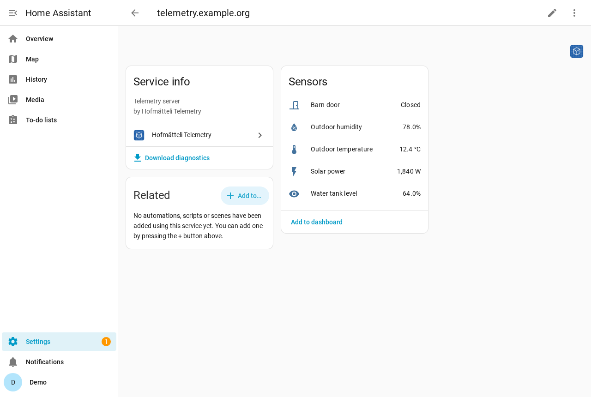

## What you get

**Sharing**

- Pick the entities to share with the normal entity picker.
- Changes are pushed as they happen, one request at a time, so a busy sensor cannot flood the server.
- Every 4 hours all selected entities are pushed again, so a sensor that never changes does not look stale.
- `unknown` and `unavailable` are not sent, so a restart does not overwrite the last good value.

**Receiving**

- Pick from the entities the server has, by name.
- Unit, device class, state class and name come from the sender, so a shared temperature is a real temperature
  sensor with history and statistics. Shared `binary_sensor.*` entities become binary sensors.
- One request per minute for all selected entities together.
- Every entity has a `stale` attribute and the time the server last got a value (`remote_last_updated`).

**Both**

- Change the selection any time under _Configure_. Deselected received entities are removed.
- When the token is rejected, Home Assistant asks you for a new one.

## Installation

### HACS (recommended)

1. In HACS, open the menu (⋮) → **Custom repositories**.
2. Add `https://github.com/herpaderpaldent/ha-hofmaetteli-telemetry` with the category **Integration**.
3. Search for **Hofmätteli Telemetry**, install it, and restart Home Assistant.

### Manual

Copy `custom_components/hofmaetteli_telemetry` into the `custom_components` folder of your Home Assistant
configuration and restart.

## Setup

**Settings → Devices & services → Add integration → Hofmätteli Telemetry**, then choose what this Home Assistant
does.

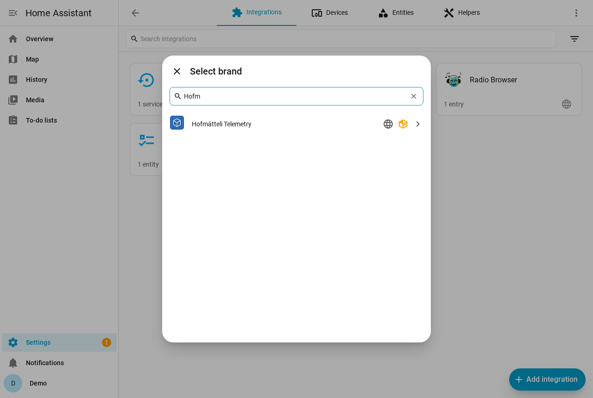

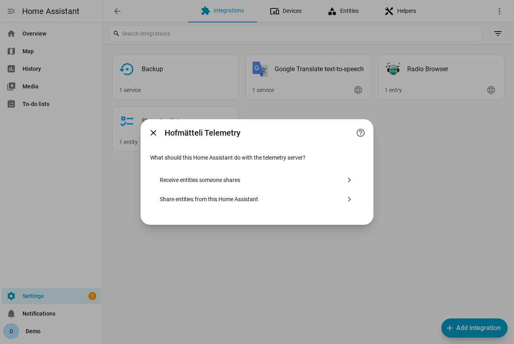

### Share entities from this Home Assistant

1. Choose **Share entities from this Home Assistant**.
2. Enter the **server URL** (for example `https://telemetry.example.org`) and a token with the `write` or `readwrite`
   role.
3. Pick the entities to share. They are sent once right away. If the token may not write, you are told here.

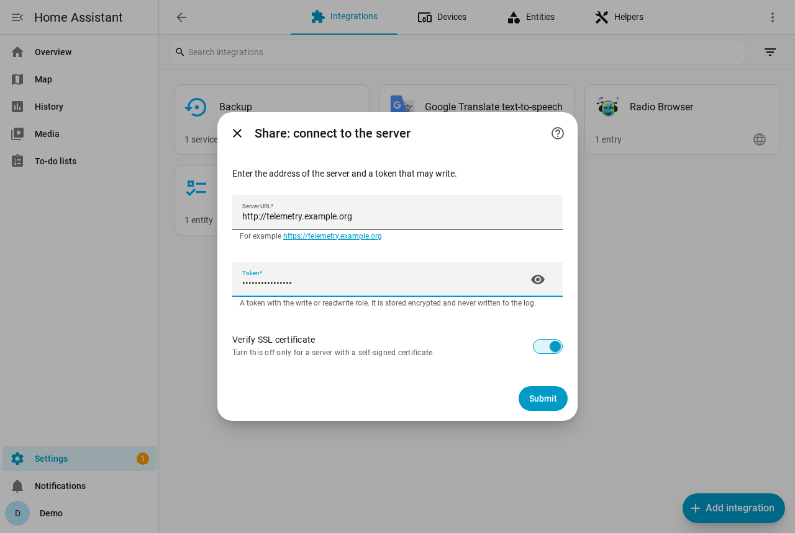

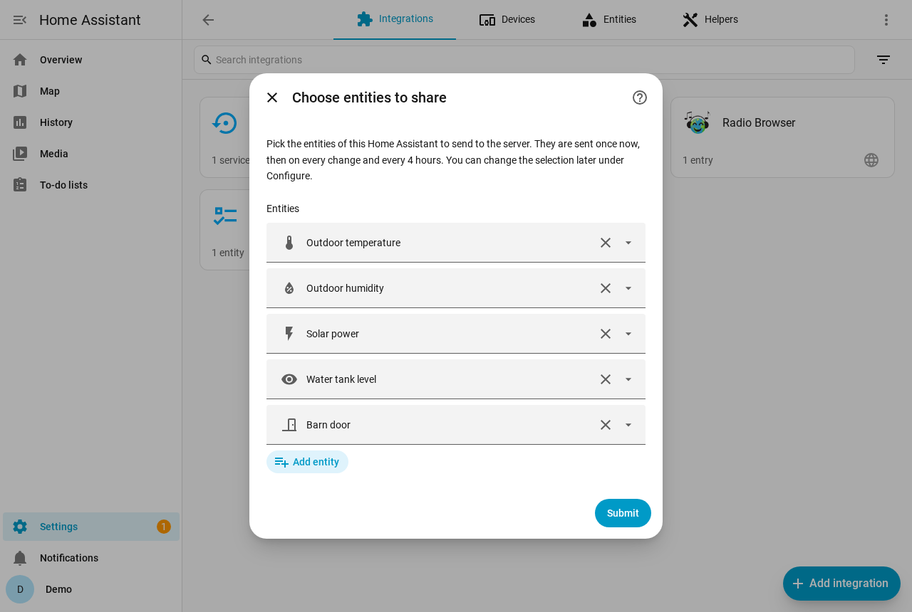

On the server, create the token with `python manage_tokens.py add --role write --label "My Home Assistant"`.

### Receive entities someone shares

1. Choose **Receive entities someone shares**.
2. Enter the **server URL** and the **read token** the sender gave you.
3. Tick the entities you want.
4. Optionally rename the device and assign it to an area.

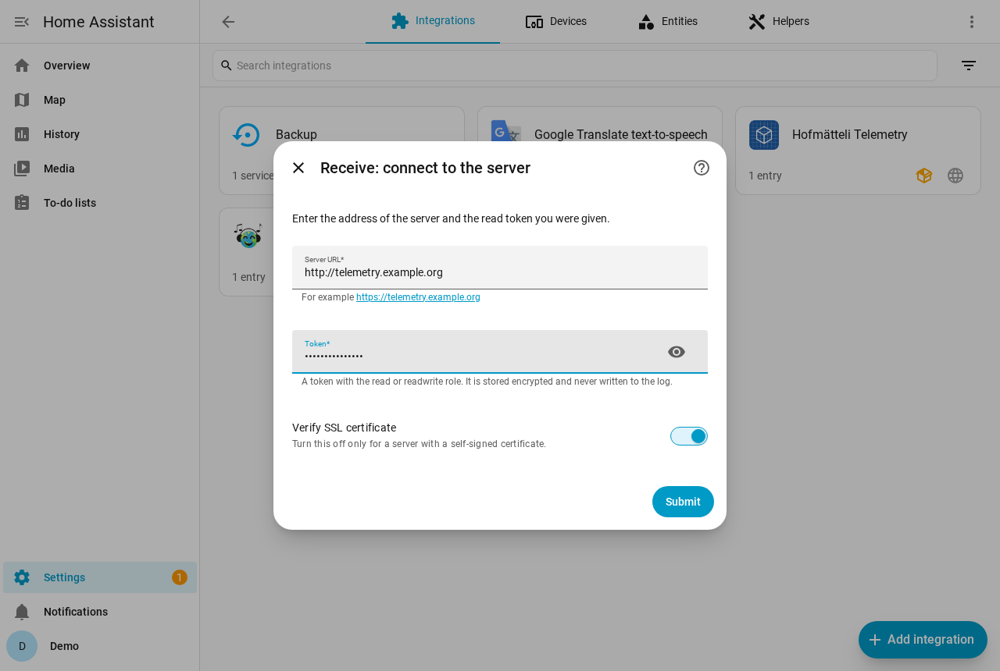

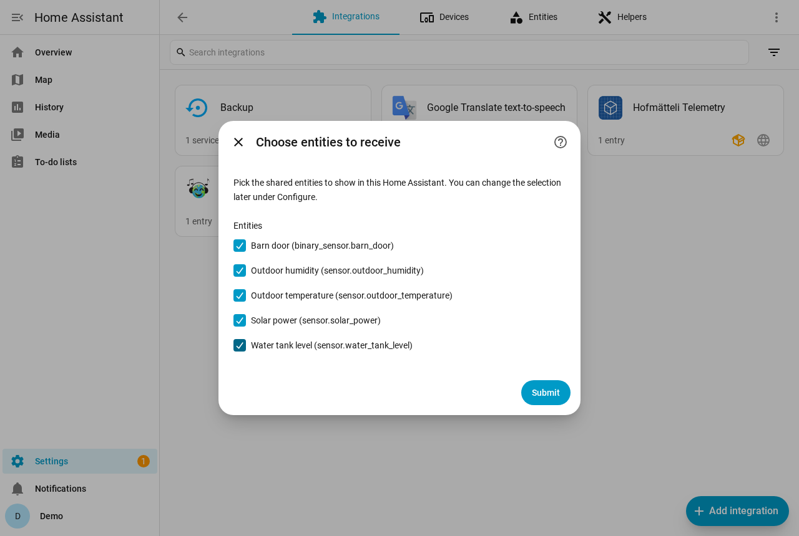

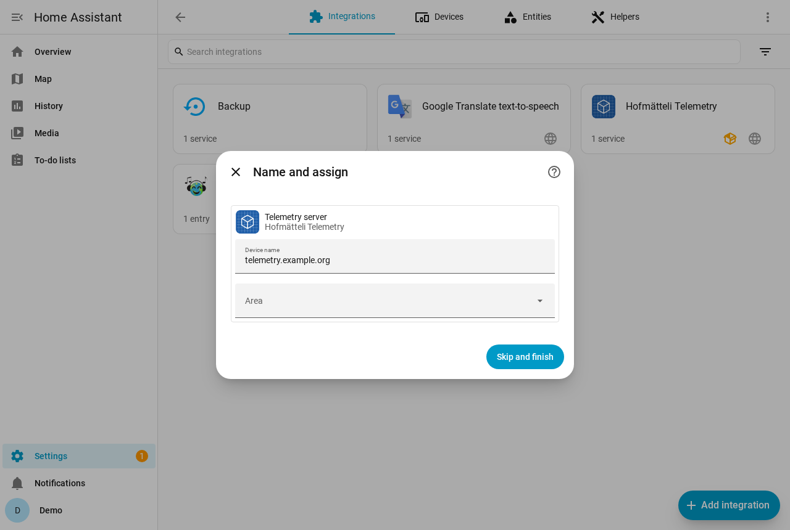

The entities appear under one device named after the server, for example
`sensor.telemetry_example_org_outdoor_temperature`. Each one carries where it came from and how fresh it is:

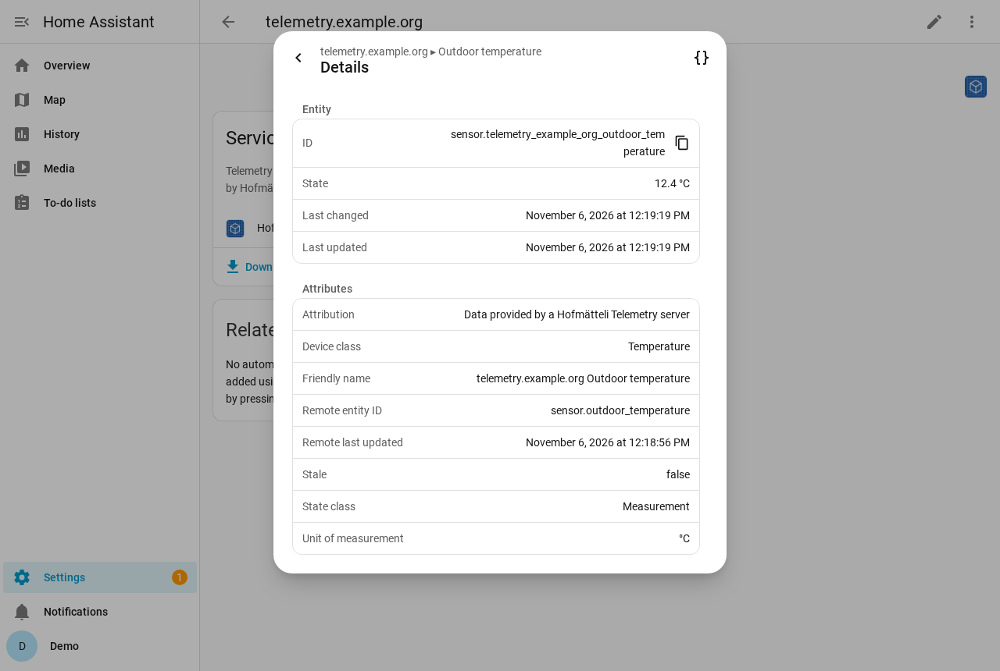

### Later changes

To change which entities are shared or received: open the entry and select **Configure**. To change the URL or token:
open the menu (⋮) and select **Reconfigure**. One Home Assistant can share to and receive from the same server; those
are two entries.

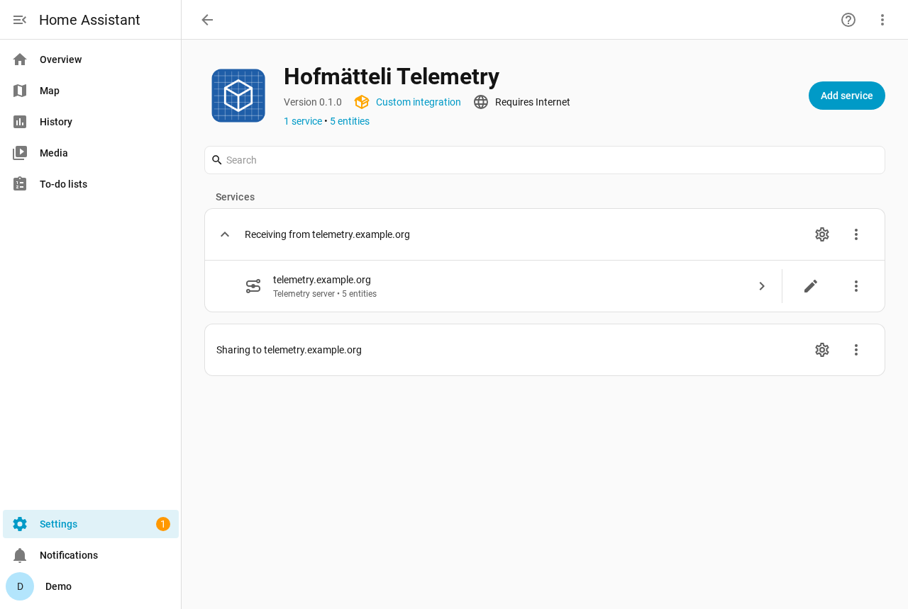

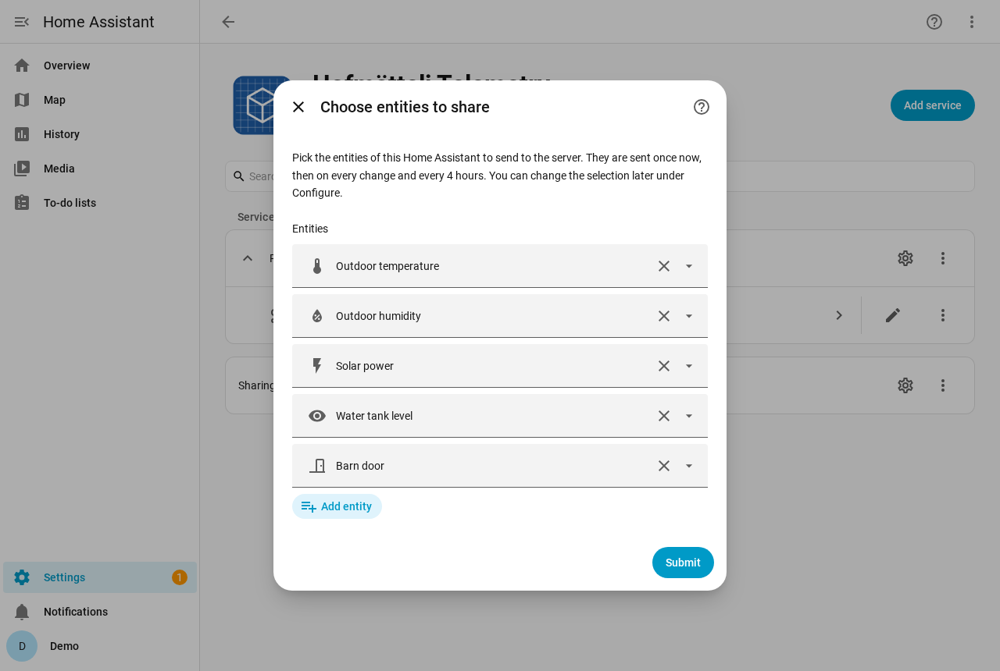

## How states are mapped

| Shared entity                                           | Shown as                                                        |
| ------------------------------------------------------- | --------------------------------------------------------------- |
| `binary_sensor.*` with state `on` / `off`               | binary sensor                                                   |
| sensor with a unit, numeric device class or state class | numeric sensor; a non-number such as `unknown` shows as unknown |
| sensor with device class `timestamp` or `date`          | timestamp / date sensor                                         |
| anything else                                           | text sensor                                                     |

Other attributes of the shared entity are kept as attributes. Entities the server stops reporting become
unavailable.

### About `stale`

`stale` is `true` when the server has not received a value for that entity for a while (5 hours by default on the
server). The integration's 4-hour heartbeat keeps unchanged sensors fresh, so `stale` means the sender is really gone.
The entity keeps its last value; use the attribute in a template or automation if you need to react to it.

This depends on the server recording when it received a value. The sharing side of this integration therefore does
not send `last_changed`. If you still push with the older YAML automation, which sends `last_changed`, unchanged
sensors will show as stale.

## Troubleshooting

- **"The server does not know this token"**: the token is wrong or was removed on the server.
- **"The token is valid but does not have the role this needs"**: receiving needs `read` or `readwrite`, sharing
  needs `write` or `readwrite`.
- **"The server does not share any entities yet"**: the sender has not pushed anything yet.
- **Debug logging**: add this to `configuration.yaml` and restart.

  ```yaml
  logger:
    logs:
      custom_components.hofmaetteli_telemetry: debug
  ```

- **Diagnostics**: the integration's menu (⋮) → **Download diagnostics**. The URL and token are redacted.

## Development

This repository was created from [ha-integration-blueprint][blueprint]. See [CONTRIBUTING.md](CONTRIBUTING.md) and
`AGENTS.md` for the tooling (`script/test`, `script/lint`, `script/type-check`, `script/hassfest`, `script/develop`).

The screenshots in `docs/images/` are taken by `script/screenshots`. Run it in the dev container, with a checkout of
the telemetry server in `.local/telemetry-server`.

---

[server]: https://github.com/herpaderpaldent/hofmaetteli_telemetry
[blueprint]: https://github.com/jpawlowski/ha-integration-blueprint
[hacs]: https://hacs.xyz
[hacsbadge]: https://img.shields.io/badge/HACS-Custom-orange.svg?style=for-the-badge
[license-shield]: https://img.shields.io/github/license/herpaderpaldent/ha-hofmaetteli-telemetry.svg?style=for-the-badge
[releases-shield]: https://img.shields.io/github/release/herpaderpaldent/ha-hofmaetteli-telemetry.svg?style=for-the-badge
[releases]: https://github.com/herpaderpaldent/ha-hofmaetteli-telemetry/releases
